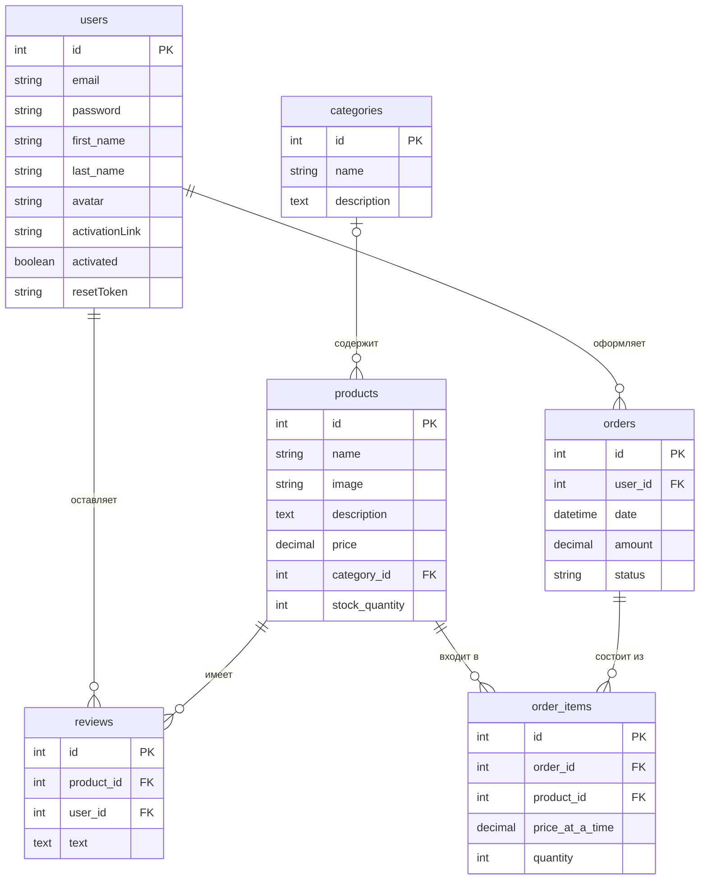

# Online Store

Серверное приложение интернет-магазина на платформе Node.js с использованием фреймворка Express.js.

## Содержание

- [Технологии](#технологии)
- [Структура проекта](#структура-проекта)
- [Установка и запуск](#установка-и-запуск)
- [Лабораторная работа №1](#лабораторная-работа-1)
- [Лабораторная работа №2](#лабораторная-работа-2)

## Структура проекта

```
online-store/
├── controllers/          контроллеры сущностей (классы с CRUD-методами)
│   ├── BaseController.js
│   ├── CategoryController.js
│   ├── OrderController.js
│   ├── OrderItemController.js
│   ├── ProductController.js
│   ├── ReviewController.js
│   └── UserController.js
├── middleware/
│   └── errorHandler.js   обработка ошибок
├── models/
│   └── models.js         модели Sequelize и связи между ними
├── routes/               маршруты (Express Router)
│   ├── index.js
│   ├── categoryRouter.js
│   ├── orderItemRouter.js
│   ├── orderRouter.js
│   ├── productRouter.js
│   ├── reviewRouter.js
│   └── userRouter.js
├── .env          пример настроек подключения
├── app.js                точка входа
├── db.js                 подключение к базе данных
├── env.js                загрузка переменных из .env
└── package.json
```

## Установка и запуск

### 1. Установите PostgreSQL

Скачайте установщик с сайта [postgresql.org](https://www.postgresql.org/download/) и установите PostgreSQL. Во время установки задайте пароль для пользователя `postgres` и запомните его. Вместе с сервером устанавливается программа pgAdmin для работы с базами данных.

### 2. Создайте базу данных

Откройте pgAdmin, подключитесь к серверу, нажмите правой кнопкой на **Databases** и выберите **Create → Database**. Введите имя `online_store` и нажмите **Save**.

То же самое можно сделать в консоли:

```bash
psql -U postgres -c "CREATE DATABASE online_store;"
```

Таблицы создавать вручную не нужно: приложение создаст их само при первом запуске.

### 3. Клонируйте репозиторий и установите зависимости

```bash
git clone https://github.com/onetosha/online-store.git
cd online-store
npm install
```

### 4. Настройте подключение к базе данных

Создайте файл `.env` и укажите в нём свои данные, в первую очередь пароль пользователя `postgres`:

```
PORT=3000
DB_NAME=online_store
DB_USER=postgres
DB_PASSWORD=ваш_пароль
DB_HOST=localhost
DB_PORT=5432
```

Файл `.env` содержит пароль, поэтому он не попадает в репозиторий (указан в `.gitignore`).

### 5. Запустите сервер

```bash
npm start
```

Для разработки используйте режим с автоматическим перезапуском при изменении файлов:

```bash
npm run dev
```

Если всё настроено правильно, в консоли появится сообщение `Сервер запущен на http://localhost:3000`. Если появилось сообщение `Не удалось подключиться к базе данных`, проверьте, что PostgreSQL запущен, база `online_store` создана, а пароль в `.env` указан верно.

Чтобы остановить сервер, нажмите `Ctrl + C`.

---

## Лабораторная работа №1

> Код этой лабораторной работы сохранён в теге `lab1`. Чтобы посмотреть его, выполните `git checkout lab1`, а чтобы вернуться к актуальной версии, выполните `git checkout main`. В текущей версии приложения API заменён на описанный в лабораторной работе №2.

### Задание

Разработать серверное приложение «Online store» на платформе Node.js с помощью фреймворка Express.js. Приложение должно возвращать список продуктов. Каждый продукт должен содержать название, описание, производителя и цену. Список продуктов хранится в массиве. Должна быть возможность выполнять CRUD-операции: получение, добавление, обновление и удаление.

### Модель продукта

| Поле | Тип | Описание |
|---|---|---|
| `id` | number | Уникальный идентификатор, присваивается автоматически |
| `name` | string | Название |
| `description` | string | Описание |
| `manufacturer` | string | Производитель |
| `price` | number | Цена |

### API

| Метод | Адрес | Описание |
|---|---|---|
| GET | `/products` | Получить список всех продуктов |
| GET | `/products/:id` | Получить продукт по `id` |
| POST | `/products` | Добавить новый продукт (все поля обязательны) |
| PUT | `/products/:id` | Обновить продукт (передаются только изменяемые поля) |
| DELETE | `/products/:id` | Удалить продукт |

Если продукт не найден, возвращается `404 Not Found`. Если при добавлении не указано какое-либо поле, возвращается `400 Bad Request`.

Данные хранятся в массиве в оперативной памяти. При запуске в нём три тестовых продукта, а после перезапуска сервера все изменения сбрасываются.

---

## Лабораторная работа №2

### Задание

1. Создать базу данных. Установить в приложение ORM Sequelize, установить соединение с базой данных и с помощью Sequelize создать модели в соответствии со схемой БД (таблицы напрямую в БД не создаются).
2. С помощью класса Router создать маршруты для каждой сущности. Для работы с сущностями создать контроллеры в виде JS-классов, методы которых выполняют CRUD-операции (получение, создание, редактирование, удаление) через Sequelize.

### Схема базы данных



Модели описаны в файле `models/models.js`. При запуске приложение вызывает `sequelize.sync()`, который создаёт в базе недостающие таблицы.

### Как устроены маршруты и контроллеры

Общие CRUD-методы `getAll`, `getOne`, `create`, `update` и `delete` реализованы в классе `BaseController`. Контроллер каждой сущности (например, `ProductController`) наследуется от него и передаёт свою модель. Для каждой сущности создан отдельный файл маршрутов с экземпляром `Router`, а в `routes/index.js` все маршруты подключаются под общим префиксом `/api`.

### API

Для каждой сущности доступен одинаковый набор операций:

| Метод | Адрес | Описание |
|---|---|---|
| GET | `/api/<сущность>` | Получить все записи |
| GET | `/api/<сущность>/:id` | Получить запись по `id` |
| POST | `/api/<сущность>` | Создать запись |
| PUT | `/api/<сущность>/:id` | Изменить запись (передаются только изменяемые поля) |
| DELETE | `/api/<сущность>/:id` | Удалить запись |

Сущности и их поля:

| Сущность | Адрес | Обязательные поля | Необязательные поля |
|---|---|---|---|
| Пользователи | `/api/users` | `email`, `password` | `first_name`, `last_name`, `avatar`, `activationLink`, `activated`, `resetToken` |
| Категории | `/api/categories` | `name` | `description` |
| Продукты | `/api/products` | `name`, `price` | `image`, `description`, `category_id`, `stock_quantity` |
| Отзывы | `/api/reviews` | `text`, `user_id`, `product_id` | — |
| Заказы | `/api/orders` | `user_id` | `date`, `amount`, `status` |
| Позиции заказа | `/api/order-items` | `order_id`, `product_id`, `price_at_a_time` | `quantity` |

Поле `id` назначается автоматически, передавать его не нужно. Поле `email` пользователя должно быть уникальным, как и название категории. Пароль пользователя не возвращается в ответах сервера.

Продукты возвращаются вместе со своей категорией, а заказы — вместе со списком позиций.

### Связи и удаление

При удалении пользователя удаляются его отзывы и заказы. При удалении заказа удаляются его позиции. При удалении продукта удаляются его отзывы и позиции в заказах. При удалении категории продукты не удаляются, у них просто очищается поле `category_id`.

### Ответы сервера

| Код | Когда возвращается |
|---|---|
| `200 OK` | Успешное получение, изменение или удаление (в ответе запись) |
| `201 Created` | Запись создана (в ответе созданная запись) |
| `400 Bad Request` | Не указано обязательное поле, нарушена уникальность, указан несуществующий `id` связанной записи или некорректный JSON |
| `404 Not Found` | Запись с указанным `id` не найдена |

### Проверка работы

Запросы GET можно открыть в браузере, например `http://localhost:3000/api/products`.

Для остальных запросов удобно использовать Postman: выберите метод, укажите адрес, а на вкладке **Body** выберите **raw** и **JSON** и введите тело запроса.

Записи, на которые ссылаются другие, нужно создавать первыми. Пример полного сценария в PowerShell:

```powershell
$api = "http://localhost:3000/api"

Invoke-RestMethod -Method Post -Uri "$api/categories" -ContentType "application/json" -Body '{"name":"Smartphones","description":"Mobile phones"}'

Invoke-RestMethod -Method Post -Uri "$api/products" -ContentType "application/json" -Body '{"name":"Galaxy S24","description":"128 GB","price":79990,"stock_quantity":5,"category_id":1}'

Invoke-RestMethod -Method Post -Uri "$api/users" -ContentType "application/json" -Body '{"email":"user@mail.ru","password":"12345","first_name":"Anton"}'

Invoke-RestMethod -Method Post -Uri "$api/reviews" -ContentType "application/json" -Body '{"text":"Great phone","user_id":1,"product_id":1}'

Invoke-RestMethod -Method Post -Uri "$api/orders" -ContentType "application/json" -Body '{"user_id":1,"amount":79990}'

Invoke-RestMethod -Method Post -Uri "$api/order-items" -ContentType "application/json" -Body '{"order_id":1,"product_id":1,"price_at_a_time":79990,"quantity":1}'

Invoke-RestMethod "$api/products"

Invoke-RestMethod "$api/orders/1"

Invoke-RestMethod -Method Put -Uri "$api/products/1" -ContentType "application/json" -Body '{"price":74990}'

Invoke-RestMethod -Method Delete -Uri "$api/reviews/1"
```

Тот же сценарий через `curl` (Linux, macOS, Git Bash):

```bash
API=http://localhost:3000/api

curl -X POST $API/categories -H "Content-Type: application/json" -d '{"name":"Smartphones","description":"Mobile phones"}'
curl -X POST $API/products -H "Content-Type: application/json" -d '{"name":"Galaxy S24","description":"128 GB","price":79990,"stock_quantity":5,"category_id":1}'
curl -X POST $API/users -H "Content-Type: application/json" -d '{"email":"user@mail.ru","password":"12345","first_name":"Anton"}'
curl -X POST $API/reviews -H "Content-Type: application/json" -d '{"text":"Great phone","user_id":1,"product_id":1}'
curl -X POST $API/orders -H "Content-Type: application/json" -d '{"user_id":1,"amount":79990}'
curl -X POST $API/order-items -H "Content-Type: application/json" -d '{"order_id":1,"product_id":1,"price_at_a_time":79990,"quantity":1}'

curl $API/products
curl $API/orders/1
curl -X PUT $API/products/1 -H "Content-Type: application/json" -d '{"price":74990}'
curl -X DELETE $API/reviews/1
```

Данные теперь хранятся в базе PostgreSQL и сохраняются после перезапуска сервера.
